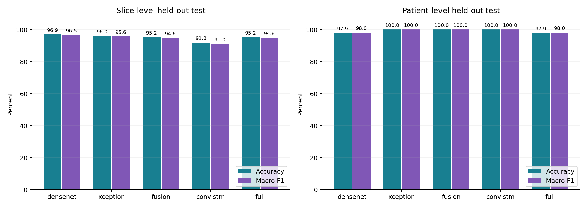
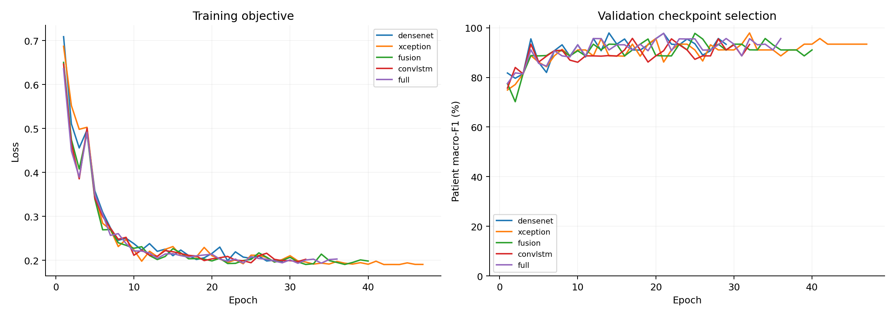
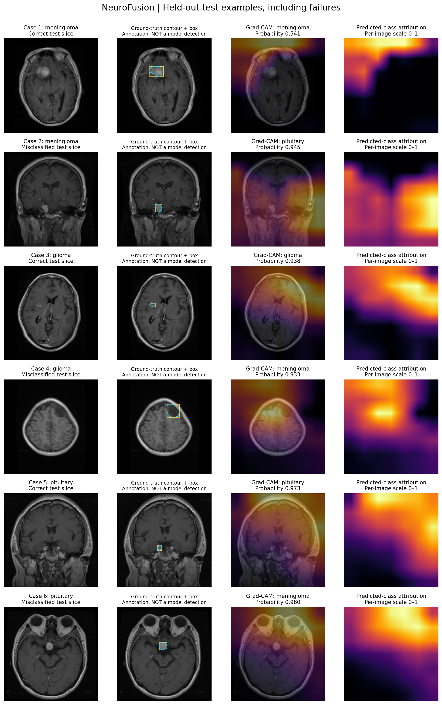
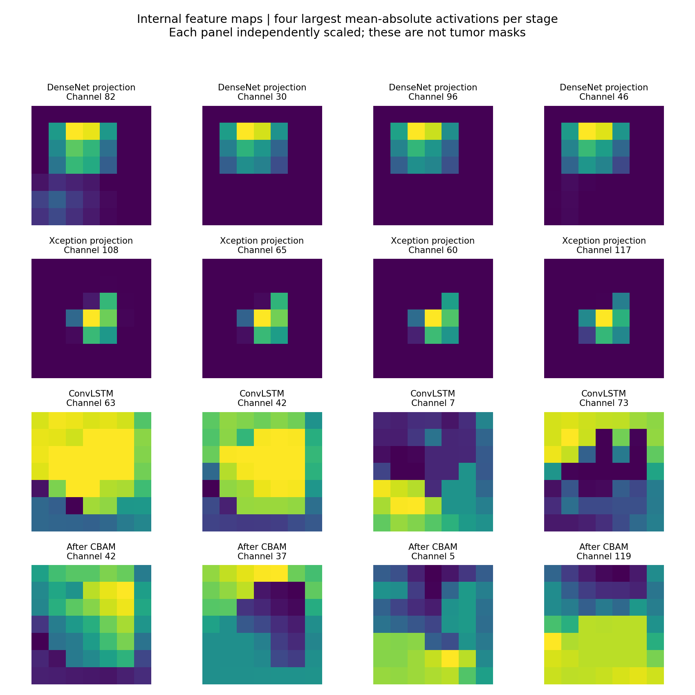
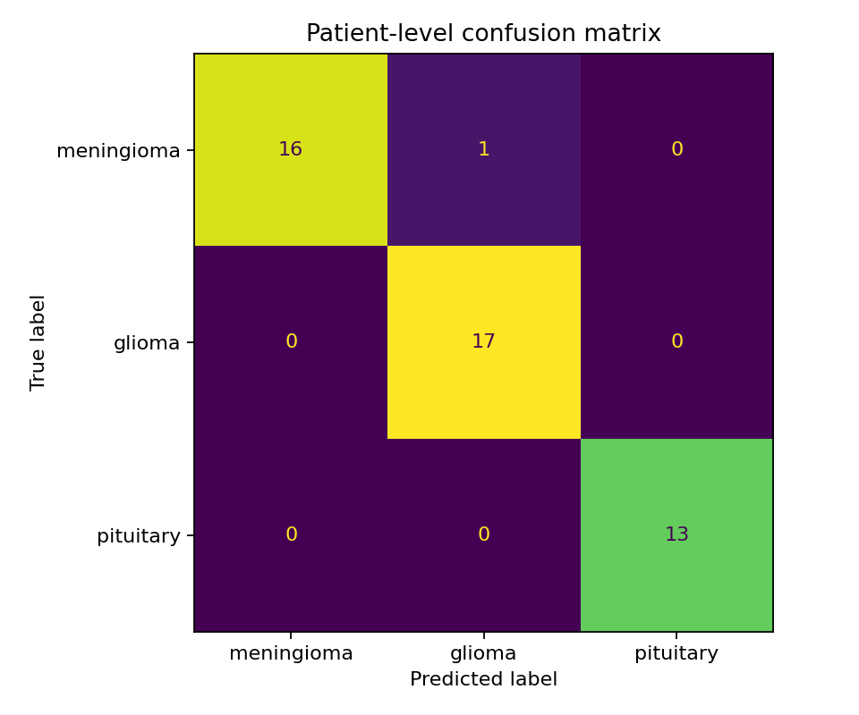
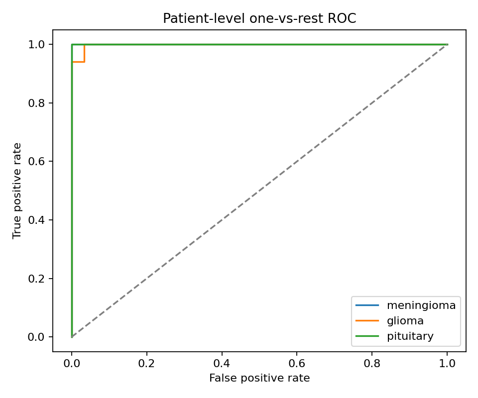

# NeuroFusion-MRI

**Patient-disjoint MRI classification · attention fusion · reproducible ablations**

Research project by **Ifza Shad**.

## Measured held-out results

| Model | Slice accuracy | Slice macro-F1 | Patient accuracy | Patient macro-F1 | Patient AUC |
|---|---:|---:|---:|---:|---:|
| densenet | 96.90% | 96.51% | 97.87% | 98.04% | 0.99477 |
| xception | 95.97% | 95.64% | 100.00% | 100.00% | 1.00000 |
| fusion | 95.19% | 94.61% | 100.00% | 100.00% | 1.00000 |
| convlstm | 91.78% | 90.96% | 100.00% | 100.00% | 1.00000 |
| full | 95.19% | 94.79% | 97.87% | 98.04% | 0.99935 |

See `results/` for raw metrics, confidence intervals, predictions and run settings.




## Qualitative analysis
from the dataset annotation; **the model does not predict boxes**. Grad-CAM highlights
features contributing to the predicted class and is not a segmentation or localization score.



Grad-CAM visualizes contributions to the predicted class. In several examples, highlighted regions do not align with the annotated tumor, including some correctly classified slices.




## Run locally

Install Python 3.10–3.12 and Git LFS. After cloning, run `git lfs pull` to obtain
actual images and weights, then `bash setup_server.sh`. Prepared images and the
fixed manifest are already in `data/prepared/`; do not generate a different split.

```bash
.venv/bin/python run.py evaluate --weights weights/full-best.pt --output runs/recheck --device 0
.venv/bin/python run.py explain --weights weights/full-best.pt --image data/prepared/images/0000.png --output runs/example --device 0
```


## Method and data

DenseNet201 and Xception features are projected to 128 channels and pooled to 7×7.
Two ConvLSTM steps represent the two backbone feature maps of one image, not MRI time
or slice order. CBAM refines the fused features before classification.
Variants: DenseNet, Xception, concatenation fusion, ConvLSTM fusion, full model.
Early stopping uses validation patient macro-F1 with patience 15, maximum 80 epochs.

Jun Cheng's [Figshare dataset v5](https://doi.org/10.6084/m9.figshare.1512427.v5),
CC BY 4.0: meningioma, glioma and pituitary tumor. Images are intensity-normalized
whole slices; masks are never classifier inputs. Patient IDs and exact-image groups
are kept disjoint across splits. Near-duplicate/site independence is not established.
See `data/DATASET_CARD.md` and `data/prepared/audit.json`.

Inspired by [Shad, Bilal and Hekmat (2025)](https://doi.org/10.31031/SBB.2025.07.000662). please cite it thank you.


Dependencies are pinned in `requirements.txt`; actual training environments are
recorded per run. `last.pt` optimizer resume is not implemented. Minor numerical
differences may occur across devices due to nondeterministic CUDA operations.
Code license: MIT. Dataset and pretrained assets retain their own licenses.
